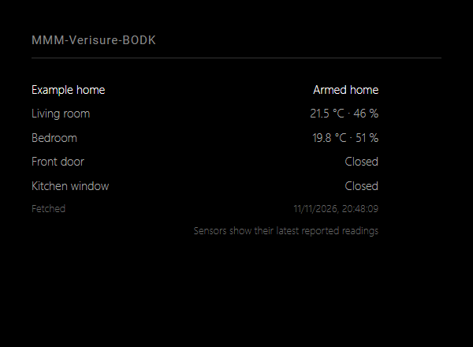

# MMM-Verisure-BODK

## Description

A MagicMirror² module displaying Verisure alarm status, temperature, humidity, and door/window contacts. English is the default display language; Danish is optional. Available information depends on the devices and data exposed by your installation. Sensor values are the latest reported readings and may not be live.

The module reads status only. It cannot arm or disarm the alarm or unlock doors. It does not replace the Verisure app or alarm monitoring.

### Preview

Default alarm and sensor display with fictional readings. No Verisure account was connected. English is the default language.



The [browser preview](docs/preview.html) uses fictional data only; it does not validate external services or hardware.

## Requirements

- MagicMirror² running Node.js 22 or later, with internet access.
- A Verisure account for the Nordic Verisure service, including Danish installations. Services in other countries may use a different API.
- The unofficial [node-verisure](https://github.com/ptz0n/node-verisure) library provides access to Verisure's cloud API without web scraping. This module is not affiliated with Verisure. Changes to the service may require updates.

## Installation

Run these commands on the device running MagicMirror²:

```sh
cd ~/MagicMirror/modules
git clone https://github.com/BravoOscarDK/MMM-Verisure-BODK.git
cd MMM-Verisure-BODK
npm install
```

Keep the folder name `MMM-Verisure-BODK` unchanged. Complete the configuration below, then restart MagicMirror² using your usual startup method.

From the module directory, authorize the account:

```sh
npm run login
```

The login wizard asks for your email and password. Your password is hidden and is not saved. If Verisure requires two-factor authentication, enter the one-time code in the terminal. Keep two-factor authentication enabled. The wizard lists the names and IDs of your installations.

The session is saved locally in `session.json` and reused/refreshed during requests. This file grants account access: protect it like a password, do not share it, and keep it out of Git. On Linux, the file is created with permissions 0600; Windows protection depends on the folder's access permissions. Run the login wizard as the same user that runs MagicMirror². If the session expires or is revoked, run `npm run login` again and restart MagicMirror².

## Configuration

Add the following entry to `modules` in `~/MagicMirror/config/config.js`:

```js
{
  module: "MMM-Verisure-BODK",
  position: "top_right",
  header: "Verisure",
  config: {
    language: "en",
    installationId: "",
    updateInterval: 300000,
    showClimate: true,
    showContacts: true,
    animationSpeed: 500
  }
},
```

Restart MagicMirror² after setup or configuration changes.

| Option | Default | Description |
| --- | --- | --- |
| `language` | `"en"` | Display language: English (`en`) or Danish (`da`). |
| `installationId` | `""` | Selects the first installation. Enter an ID from the login wizard to select a specific installation. |
| `updateInterval` | `300000` | Milliseconds between updates; minimum 60000, maximum 3600000. |
| `showClimate` | `true` | Shows temperature and humidity where available. |
| `showContacts` | `true` | Shows door/window contacts where available. |
| `animationSpeed` | `500` | Display animation duration in milliseconds. |

Multiple module instances can display different installations on the same account. They share a login session. Do not put your email, password, or cookies in the MagicMirror² configuration or share them in chat. Only display data is sent from the node helper to the mirror.

Built-in messages and date formatting follow the module language. Installation names and sensor names are displayed as returned by Verisure.

## Language

English is the default, independently of the MagicMirror² global language. Set the language in this module's `config`:

```js
language: "en" // English (default); use "da" for Danish.
```

Unsupported languages fall back to English. Custom labels, device names and upstream data retain their configured or reported values. Technical logs and diagnostic errors are in English.

## Updating

For an installation created with `git clone`:

```sh
cd ~/MagicMirror/modules/MMM-Verisure-BODK
git pull --ff-only
npm install
```

Restart MagicMirror² using your usual startup method. Keep your module settings in `~/MagicMirror/config/config.js`. If Git reports local changes or diverging branches, preserve those changes and resolve the issue before updating. A ZIP download or copied folder must be replaced manually or migrated to a Git clone before using `git pull`.

## Troubleshooting

- Missing session: run `npm run login` in the module folder.
- Login or connection failure: check the Verisure app and your internet connection. Then try logging in again and restart MagicMirror².
- Unknown alarm status means the API did not return a recognized status. It is not treated as disarmed.
- Partial API failures display a warning. On a complete failure, the last result remains visible and is marked as stale. Retries use an increasing interval, up to one hour.
- Sensors that are absent or returned as null are not displayed.
- No alarm PIN is required.

## Validation

```sh
npm test
```

Automated tests do not establish hardware compatibility. Verify the module on your own MagicMirror² installation.

Tests simulate the API without accessing your account. Verify actual login and sensor data on your own mirror after installation.

## License

MIT. See [LICENSE](LICENSE) for license terms and attribution.
